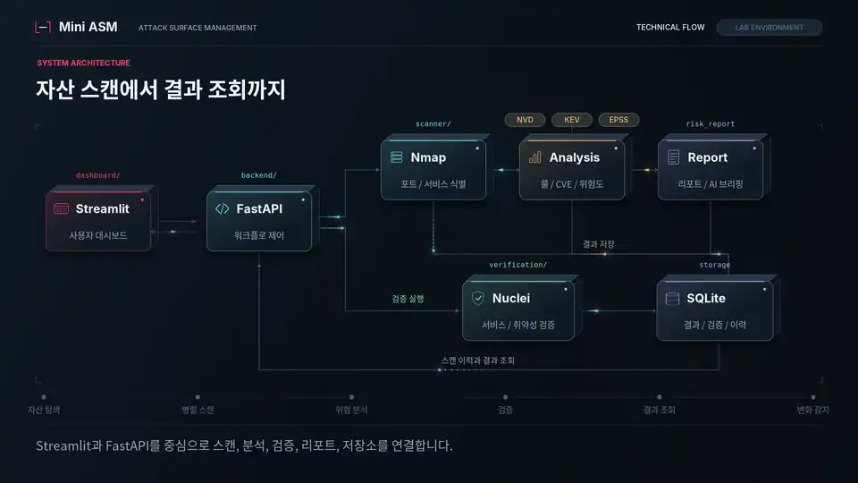
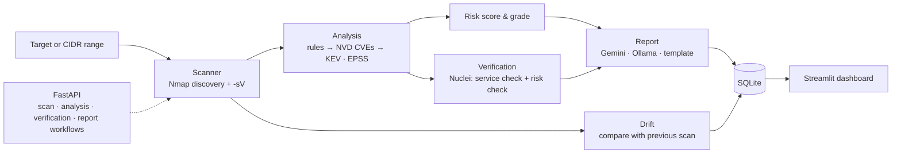

# Mini ASM

**An attack surface workbench: discover what's exposed, see what changed, and prove what's actually vulnerable.**

Mini ASM (Attack Surface Management) runs the full loop in one place: sweep a network range for live hosts, fingerprint their services, enrich findings with live CVE, KEV and EPSS data, verify them with Nuclei, compare against the last scan to catch drift, and summarize it all in an AI briefing.

<p align="center">
  <a href="media/mini-asm.mp4"></a>
  <br>
  <sub>Preview runs at 1.35× speed. <a href="media/mini-asm.mp4">Watch the full video (0:54)</a></sub>
</p>

## Why

A port scan tells you what's open, not what matters. Teams end up with long lists of services, CVE matches nobody has confirmed, and no memory of what the network looked like last week. Mini ASM connects the steps that are usually separate tools: discovery, risk, verification and change tracking, so each finding arrives with how risky it is, whether it was confirmed, and whether it is new.

## Features

- **Asset discovery.** Sweep a CIDR range, find live hosts and queue them for scanning.
- **Parallel service scans.** Nmap `-sV` runs per target in parallel to collect ports, services, versions and CPEs.
- **Live vulnerability enrichment.** Rule-based findings are expanded with CVEs from NVD (CPE-based lookup), CISA KEV status and FIRST EPSS scores.
- **Risk scoring.** Each host gets a 0–100 score and grade from severity weights, KEV and EPSS bonuses, and bonuses for risky service combinations (for example Redis exposed alongside SSH).
- **Two-layer verification.** Nuclei templates check separately whether the service really exists and whether the vulnerable condition holds, so each finding ends up *verified*, *suspected* or *not verified*, with evidence stored.
- **Drift detection.** Each scan is compared with the previous one to surface opened and closed ports and new or missing hosts.
- **AI briefing.** Gemini turns the results into a narrative risk report, with a local Ollama model or a template as fallback.
- **Dashboard.** A Streamlit dashboard for runs, findings, verification history, drift and reports, backed by a FastAPI service with OpenAPI docs.

## How it works



The repository ships a practice lab of intentionally vulnerable containers (Juice Shop, Tomcat CVE-2017-12615, unauthenticated Redis, SambaCry, MySQL CVE-2012-2122, Elasticsearch CVE-2015-1427 and vsftpd 2.3.4) and scenario scripts that change their exposure on demand, so drift detection and verification can be exercised end to end.

## Getting started

```bash
cp .env.example .env    # optional: NVD_API_KEY, GEMINI_API_KEY, live lookup toggles
docker compose up -d --build
```

| Service | URL |
|---|---|
| Dashboard | http://localhost:8501 |
| API docs | http://localhost:8000/docs |
| Health | http://localhost:8000/health |

```bash
docker compose down      # stop
docker compose down -v   # stop and reset volumes
```

Live NVD, KEV and EPSS lookups are opt-in through `ANALYSIS_USE_LIVE_*` in `.env`.

## Scope

Mini ASM implements and validates the ASM workflow end to end. It handles parallel and range scans, but it is not built for tens of thousands of assets, and some scenarios and verification templates target the bundled lab. Only scan networks you are authorized to test.

## Tech stack

Python · Nmap · Nuclei · FastAPI · Streamlit · SQLite · Docker Compose · NVD / CISA KEV / FIRST EPSS APIs · Gemini · Ollama

---

More projects at [hhkb.dev](https://hhkb.dev) · [Intbox](https://intbox.org)
